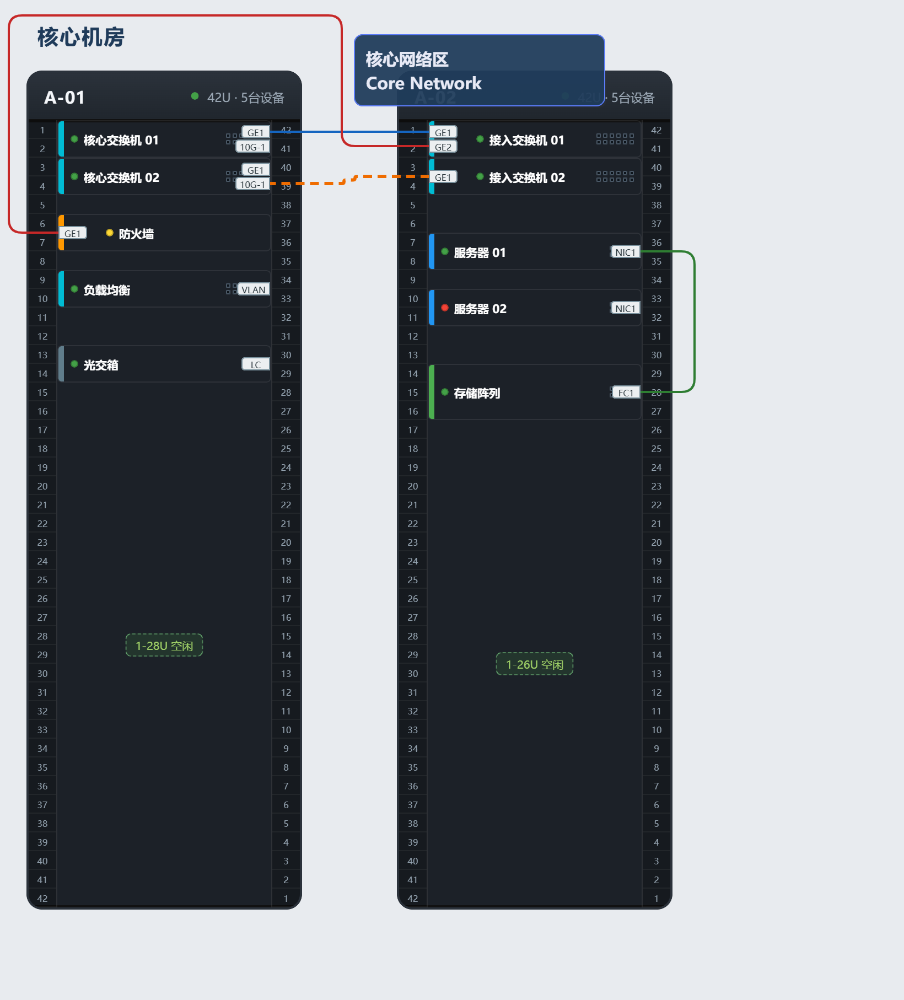
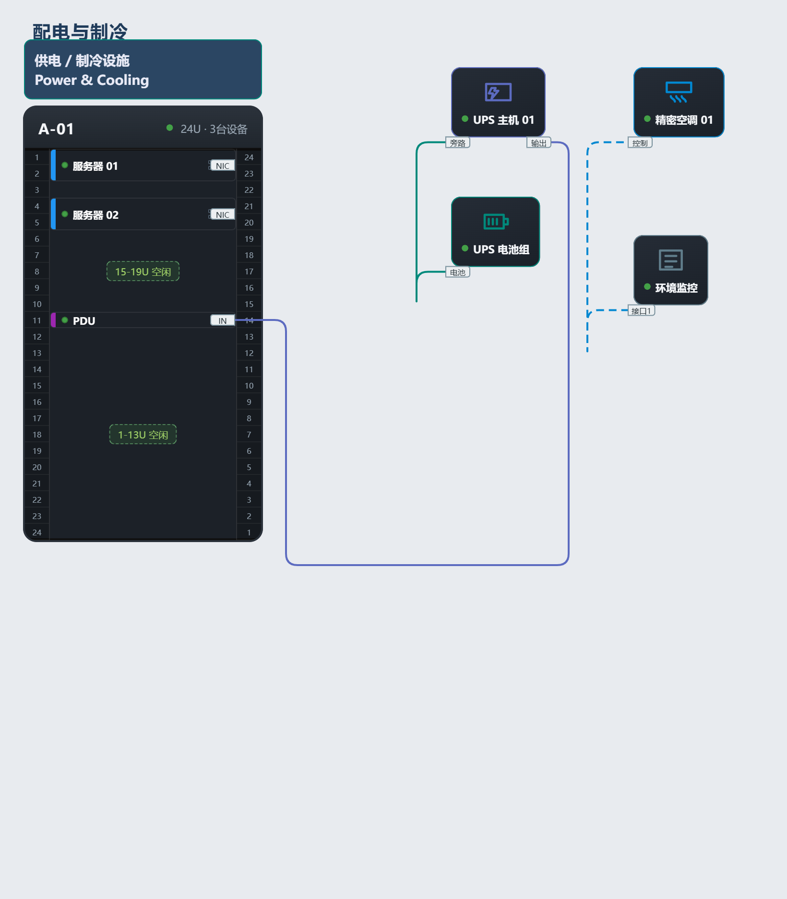
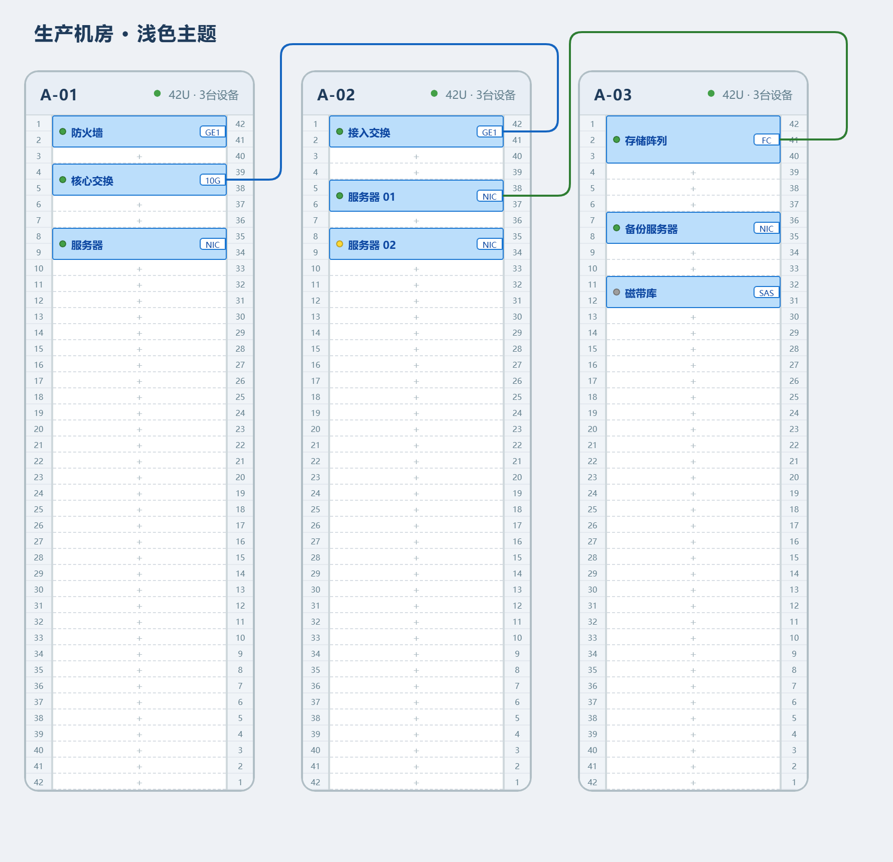
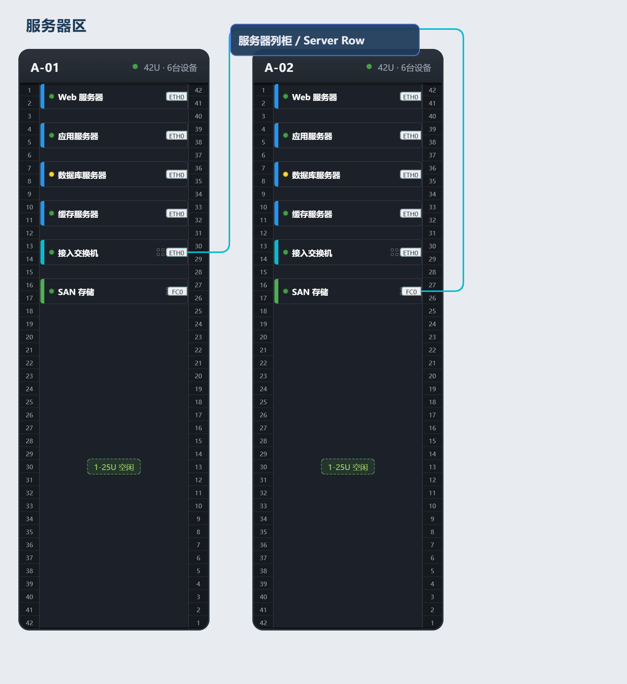

# Rack Topology Editor / 机房机柜拓扑编辑器

> A pure front-end, single-file, fully offline rack topology drawing tool.
> 一个**纯前端、单文件、完全离线**的机房机柜拓扑绘图工具。

[中文](#中文说明) · [English](#english)

---

## English

An offline rack-topology drawing tool for data centers and server rooms. Just double-click the HTML file to open it in your browser — no server, no internet connection required.

### Live Demo / Download
- **Online**: https://it-xiao-word.github.io/rack-topology/
- **Download (single file)**: https://raw.githubusercontent.com/it-xiao-word/rack-topology/main/rack-topology.html

### Features
- **Multi-room management** — each room has its own independent topology; freely create, switch, and rename rooms.
- **Racks & devices** — custom U height and size; drag devices into racks, adjust U positions, configure ports on left/right sides, status lights, and hover details.
- **Cables** — click one port to start a connection, then another to finish; cross-rack cables auto-route around racks; control points are draggable; arrowheads scale with line width.
- **Facilities** — UPS, battery banks, air conditioners, and other devices that don't occupy U space; freely place, resize, and connect them.
- **Text boxes** — freely drag, resize, and double-click to edit; new topologies include a built-in "Quick Start" guide.
- **View** — canvas zoom, light/dark themes, room-label toggle, and alignment/distribution tools.
- **Export** — PNG / Excel / PDF; JSON import/export with multi-room selection, plus copy/paste config for cross-device migration.
- **Save** — the top "Save" button writes a dated JSON file; reopening loads the last save automatically.

### Screenshots

**Core network — dual racks with cross-rack cables**

**Power & cooling facilities — UPS, battery, AC, and cabling**

**Light theme — three aligned racks with status lights**

**Server rows — high-density devices with status indicators**

### How to use
Open `rack-topology.html` with Chrome or Edge and start editing.

**Where data lives**: topology config is stored in the browser's `localStorage` — it is **not written into the HTML file** and does not travel with it.
- **Same computer**: click "Save" in the top bar; the last save loads automatically next time.
- **Cross-device migration**: use File → JSON Export / Copy Config on the source, then JSON Import / Paste Config on the target.
- **Cloud backup / multi-device sync**: keep exported JSON files in cloud storage, or host this file plus config files in a repo.

### Files
| File | Description |
| --- | --- |
| `rack-topology.html` | Main offline file, with html2canvas / jsPDF / SheetJS inlined — PNG / Excel / PDF export works offline |

### Privacy & Security
- All logic runs locally in the browser; nothing is uploaded to any server.
- Room names are HTML-escaped when importing JSON to prevent script injection.

### License
For personal and internal operations use only.

---

## 中文说明

一个机房机柜拓扑绘图工具，**纯前端、单文件、完全离线**。双击 HTML 文件即可在浏览器中打开，无需服务器、无需联网。

### 在线体验 / 下载
- **在线使用**：https://it-xiao-word.github.io/rack-topology/
- **下载单文件**：https://raw.githubusercontent.com/it-xiao-word/rack-topology/main/rack-topology.html

### 功能特性
- **多机房管理**：每个机房拥有独立的机柜拓扑，可自由新建、切换、重命名。
- **机柜与设备**：自定义 U 数 / 尺寸，设备可拖入机柜、调整 U 位，端口支持左右侧设置、状态灯与悬停详情。
- **连线**：点击端口进入连接模式，跨机柜自动绕行，控制点可拖动调整走向，箭头随线宽变化。
- **独立设施**：UPS 主机、电池组、空调、其他设备，不占 U 位，可自由摆放、缩放与连线。
- **文本框**：自由拖拽、缩放、双击编辑，新建拓扑自带「快速上手」说明。
- **视图**：整体缩放、深浅主题、机房名标签显隐、对齐与分布工具。
- **导出**：PNG / Excel / PDF；JSON 支持按机房多选导入导出，另有复制/粘贴配置便于跨设备迁移。
- **保存**：顶部「保存」自动写出带日期的 JSON，重新打开自动载入最后一次保存。

### 效果截图

**核心网络 —— 双机柜与跨柜连线**

**供电与制冷 —— UPS、电池、空调及连线**

**浅色主题 —— 三机柜对齐与状态灯**

**服务器列柜 —— 高密度设备与状态指示**

### 使用方法
直接用 Chrome / Edge 打开 `rack-topology.html` 即可开始编辑。

**数据存放说明**：拓扑配置保存在浏览器的 `localStorage` 中，**不写入 HTML 文件本身**，也不会随文件一起传输。
- **同一台电脑**：编辑后点顶部「保存」，下次打开自动载入最后一次保存。
- **跨设备迁移**：用「文件 → JSON导出 / 复制配置」把配置带到目标设备，再「JSON导入 / 粘贴配置」载入。
- **云端备份 / 多设备同步**：建议把导出的 JSON 放入网盘，或使用 GitHub 仓库托管本文件 + 配置文件。

### 文件说明
| 文件 | 说明 |
| --- | --- |
| `rack-topology.html` | 离线版主文件，内联了 html2canvas / jsPDF / SheetJS，断网也能导出 PNG / Excel / PDF |

### 隐私与安全
- 全部逻辑在浏览器本地运行，不向任何服务器上传数据。
- 导入 JSON 时对机房名做了 HTML 转义，防止脚本注入。

### 许可
仅供个人与内部运维使用。

---

## Support / 打赏

If this tool helps you, feel free to buy me a coffee. 如果这个项目对你有帮助，欢迎打赏支持。

